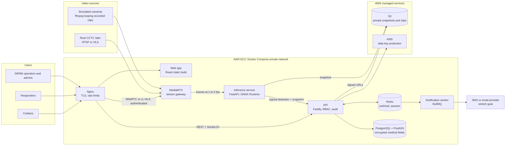
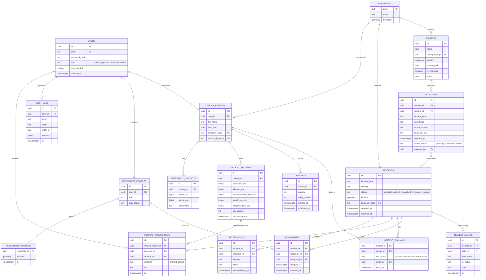

# Infrastructure proposal

**Status: approved on 2026-11-07.** Nothing here has been provisioned yet. Region: Singapore (`ap-southeast-1`). Budget: $149 in AWS credit, to be confirmed on the new account. Domain: none yet.

## Recommended stack

| Area | Recommendation | Main reason |
|---|---|---|
| Frontend | React, Vite, TypeScript, Tailwind, shadcn/ui, Framer Motion | A static app works directly with a PWA or Capacitor later |
| Map | MapLibre GL with a self-hosted Negros map extract | Live vector overlays, no API key, works without a third-party tile service |
| API | Fastify (TypeScript) with Zod | OpenAPI generated from the validation schemas |
| AI service | Python FastAPI with ONNX Runtime | Same service runs on CPU or GPU |
| Detector | D-FINE or RF-DETR (Apache 2.0), chosen by benchmark | Avoids AGPL obligations on your application |
| Database | PostgreSQL with PostGIS, Redis | Barangay lookups and nearest-responder queries built in |
| Real-time | Socket.IO, with PostgreSQL as the source of truth | Rooms and delivery acknowledgements for critical alerts |
| Video | MediaMTX gateway | Simulated and real cameras use the same pipeline |
| Hosting | One EC2 instance, Docker Compose, Nginx, Let's Encrypt | Lowest cost and fastest to run |
| Compute | CPU first (`c7i.2xlarge`), GPU only if the benchmark fails | Avoids paying for a GPU you may not need |
| Deploy | GitHub-hosted runners and AWS SSM | No inbound SSH needed |

## Architecture

**Detection flow**

1. A detection counts only if it persists across several frames (for example, 3 of 5). This cuts one-frame false positives.
2. Above the threshold, it becomes an Incident in `Detected` and alerts operators. Below the threshold, it goes to the verification queue.
3. Dispatch always requires an operator action. The system never auto-dispatches.
4. Thresholds are set per class and per camera, because one global number won't suit both fire and person-down detection.

## Cameras you own

The system uses **cameras you own or buy, not existing public or LGU CCTV**. The demo stays on simulated feeds, and the same pipeline accepts a real camera later.

| Area | What this means |
|---|---|
| Access | No third-party footage agreement is needed, which removes a major dependency |
| Legal duties | **These don't go away.** As the camera operator you'd be the personal information controller. [NPC Circular 2024-02](https://privacy.gov.ph/wp-content/uploads/2024/08/NPC-Circular-No.-2024-02-CCTV-Systems.pdf) counts streets, schools, markets and evacuation centers as public spaces, whoever owns the camera. Notices, a declared purpose and retention limits still apply |
| Placement | You'd need permission from the property owner or barangay at each site |
| Purchase criteria | RTSP or ONVIF support without a vendor cloud, night vision, weather rating for outdoor use |
| Network | **Open design question.** Streaming video from every site to Singapore needs steady upload bandwidth, which may be scarce in rural barangays. An on-site mini-PC running inference and sending only alerts and snapshots may suit a real pilot better. The inference service can run in either place, so this can wait for site measurements |
| Cost model | The deck needs real quotes for cameras, power, connectivity and compute. **None have been collected yet** |

This also supports the 30% Viability criterion, because owning hardware makes the per-site cost concrete.

## Data model

## Options and trade-offs

Build speed assumes a small team under a hackathon deadline. Cost is the running cost of the software itself; hosting is covered under "Cloud".

### Frontend

| Option | Cost | Latency | Build speed | Scalability | Notes |
|---|---|---|---|---|---|
| **React, Vite, TS (recommended)** | Free | Fast after first load | Fast; shadcn/ui ports directly | Static files scale easily | Best fit for PWA or Capacitor |
| Keep Next.js, upgraded | Free | Fast first load | Fastest for existing screens | Good | SSR adds little behind a login. Capacitor is harder with server routes |

**Motion:** Framer Motion only. GSAP isn't needed, because operations UI needs state transitions rather than choreographed sequences. All motion respects `prefers-reduced-motion`.

### Map

| Option | Cost | Build speed | Notes |
|---|---|---|---|
| **MapLibre GL + PMTiles (recommended)** | S3 storage only | Medium | Smooth with many live markers, dark basemap, no API key |
| Leaflet + raster OSM tiles | Free for light use | Fastest | Simpler, but OSM's public tile servers have a usage policy, and dark styling is limited |
| Google Maps | Usage-based, needs a billing account | Fast | Vendor lock-in; no benefit here |

**Boundary data is verified.** [`faeldon/philippines-json-maps`](https://github.com/faeldon/philippines-json-maps) has a Kabankalan file (`bgysubmuns-municity-1804515000`) with exactly 32 barangay polygons, matching PSA's count. Attribution to NAMRIA and PSA through OCHA's COD-AB is required. Note that PSGC moved Kabankalan to code `1804515000` under the Negros Island Region, while older sources use `064515000`.

### Backend API

| Option | Build speed | Scalability | Notes |
|---|---|---|---|
| **Fastify + Zod (recommended)** | Fast | Good | Schemas produce validation and the OpenAPI reference, and rate limiting is a plugin |
| Express | Fast | Good | Most familiar, but OpenAPI and validation are extra wiring |
| NestJS | Slower | Very good | Strong structure, but heavy for a hackathon |

### AI and computer vision

**Licensing affects this choice.** [Ultralytics states](https://www.ultralytics.com/license) that YOLO code and models trained with it are AGPL-3.0 by default, so a networked product must open-source its application or buy a license. This is workable only if you plan to open-source BantayBuhay, and that decision is blocked until upstream licensing is settled.

| Option | License | Strength | Weakness |
|---|---|---|---|
| **D-FINE-N/S (recommended for CPU)** | Apache 2.0 | Small (3.8M and 10.2M parameters) | Less convenient tooling |
| **RF-DETR-N/S (recommended for GPU)** | Apache 2.0 | Strong accuracy, simple training package | About 30M parameters; likely slower on CPU |
| YOLO26 | AGPL-3.0 or paid | Most tutorials and easy export | License obligations above |
| Zero-shot (OWLv2, Grounding DINO) | Check each | No training needed | Slow, and needs a GPU. Better for pre-labeling data than for live inference |
| External vision API as a second check | Paid per call | Good on ambiguous scenes | Sends CCTV frames off-platform, which is a privacy issue. Needs faces masked and a legal basis |

Published latency figures come from the [RF-DETR benchmark table](https://github.com/roboflow/rf-detr), which is vendor-published and GPU-based. **I have no CPU numbers for these models yet**, so a benchmark comes first.

**One detector won't cover every incident type:**

| Incident | Approach | Feasibility | Recommendation |
|---|---|---|---|
| Fire and smoke | Fine-tuned detector on D-Fire (21,000+ images) | High | **MVP** |
| Person down | Person detection, pose estimation and tracking; down and motionless for N seconds | Medium to high | **MVP** |
| Flood | Water segmentation or scene classifier, plus a calibrated zone per camera | Medium | **MVP** |
| SOS gesture | Existing MediaPipe logic | High; already works | **MVP**: cheap and distinctive |
| Vehicular accident | Vehicle tracking with sudden-stop and overlap rules | Medium to low | **Stretch**, first to add |
| Crowd surge | Person density and optical flow | Medium to low; false-alarm prone | Stretch |
| Structural collapse | No good public dataset that I found | Low | Manual report only |

**Check dataset licenses before training.** D-Fire's own README says its images remain subject to their source providers' terms, so a CC0 tag on a re-upload isn't reliable.

**Evaluation:** report precision, recall, latency and false alarms per camera-hour by class, on a held-out set. Public-dataset results don't prove performance on Kabankalan cameras, and the paper will say so.

### Where inference runs

Prices are AWS on-demand Linux in Singapore (`ap-southeast-1`), from AWS's public price file on 2026-11-07. Monthly figures use 730 hours.

| Option | Compute cost | Latency | Build speed | Scalability | Risk |
|---|---|---|---|---|---|
| **A. One CPU instance, `c7i.2xlarge` (recommended)**: 8 vCPU, 16 GB | $0.4116/h, $300/mo if left running | Must be measured | Fastest | Few cameras | May not hold the target frame rate |
| **B. App on `t3.large`, plus `g4dn.xlarge` GPU during demos** | $0.1056/h + $0.736/h; GPU on 24/7 is $537/mo | Lowest | Medium | Good | GPU quota is often zero on new accounts, and increases can take time |
| **C. Your existing EC2 plus inference on a team laptop** | No added compute | Depends on venue internet | Medium | Poor | Venue Wi-Fi becomes a single point of failure |

**How to decide:** run a one-hour benchmark on `c7i.2xlarge`, for about $0.41 plus a little storage. You've approved up to $5, which is about 12 hours. The target is 4 simulated cameras at 2 fps each, or 8 inferences per second. Move to Option B only if that fails.

**Limits on the first AWS account, checked 2026-11-07.** The project is moving to another account, and these settings are per account, so they must be rechecked there:

- **GPU quota is 0 vCPUs in Singapore,** so `g4dn.xlarge` can't launch until AWS approves an increase. Requesting one costs nothing, but approval can take time.
- **Standard quota is 8 vCPUs.** A `c7i.2xlarge` uses all 8, so it can't run alongside another instance. Running a `t3.large` with it would need an increase to at least 10.
- **A $50 monthly budget already exists.** Alerts don't stop spending, so the plan below can pass $50 if the GPU fallback is used.

**Your budget is $149 in AWS credit.** Check its expiry date and covered services under Billing > Credits, because I can't see those terms. The plan below stays well under the credit:

| Item, through Nov 21 | Hours | Estimated cost |
|---|---|---|
| App host, `t3.large`, from Nov 11 | 240 | $25.34 |
| `c7i.2xlarge`: benchmark, demo recording, rehearsals | 22 | $9.06 |
| GPU fallback, `g4dn.xlarge`, only if needed | 20 | $14.72 |
| Public IPv4 address (approximate) | 240 | $1.20 |
| EBS storage, 50 GB (approximate) | | Under $5 |
| **Total, including the GPU fallback** | | **About $55** |

**Stop instances when idle.** Left running 24/7, `c7i.2xlarge` costs $9.88 a day, using the whole credit in about 15 days. `g4dn.xlarge` costs $17.66 a day, using it in about 8 days.

AWS reports that `g5.xlarge` and `g6.xlarge` aren't offered in Singapore, so `g4dn.xlarge` is the GPU option there.

**The first account's instance wasn't suitable.** It's a stopped `t3.medium` (2 vCPU, 4 GB) named for the PESO project. It's too small for this stack, and medical data shouldn't share a host with another project. Avoid burstable `t3` instances for continuous inference, because they exhaust CPU credits. While stopped, its storage and Elastic IP still cost a little.

### Database

| Option | Build speed | Scalability | Notes |
|---|---|---|---|
| **PostgreSQL + PostGIS (recommended)** | Fast | Good | Finds a camera's barangay and nearest responders in plain SQL |
| MySQL 8 | Fast; team knows it | Good | Weaker spatial functions; the existing schema gets rebuilt anyway |
| TiDB | Medium | Excellent | Solves a scale problem you don't have. Confirm spatial support before considering it |

**Redis:** recommended for Socket.IO fan-out and notification queues. PostgreSQL `LISTEN/NOTIFY` could replace it, but BullMQ retries are worth keeping for alerts.

### Real-time

| Option | Latency | Build speed | Notes |
|---|---|---|---|
| **Socket.IO (recommended)** | Low | Fast | Rooms by role and incident, acknowledgements, reconnection, two-way traffic for responder positions |
| SSE | Low | Fast | Simple and proxy-friendly, but one-way, so positions need separate requests |

With either choice, clients refetch state after reconnecting. The database stays authoritative, so a dropped connection can't lose an incident.

### Cloud services

| Decision | Recommendation | Why |
|---|---|---|
| Region | Singapore | Close to the Philippines with broad service coverage. Confirm any data-residency expectations with the LGU |
| Media | Private S3 bucket with signed URLs, lifecycle expiry | CCTV footage must have a retention limit |
| RDS or self-hosted | **Self-hosted in Docker for the hackathon**, with encrypted backups to S3. **Move to RDS before real data** | RDS adds cost now, but automated backups and failover are worth it for real medical records |
| Keys | AWS KMS for wrapping data keys | Keys stay out of the app host, at low cost |

### Containers

Docker Compose, Nginx and Let's Encrypt, as you suggested. Only Nginx publishes ports. PostgreSQL, Redis, MediaMTX's internal ports and inference stay on private Docker networks.

**Known limit:** one EC2 instance is a single point of failure. That's fine for a demo, but not for real emergency operations, which would need multi-AZ redundancy.

## Security and privacy design

**CCTV and medical records need different legal bases.** [NPC Circular 2024-02](https://privacy.gov.ph/wp-content/uploads/2024/08/NPC-Circular-No.-2024-02-CCTV-Systems.pdf) says consent may not be the most suitable basis for open surveillance in public places. It also requires visible CCTV notices, and formal arrangements govern third-party access to footage. Medical profiles, by contrast, use the explicit consent you specified.

| Requirement | Design |
|---|---|
| Consent | Versioned record per purpose. Withdrawal removes access to the medical record |
| Field-level encryption | AES-256-GCM per record, with data keys wrapped by KMS. PostgreSQL only stores ciphertext |
| Access rule | One server-side policy function: the user is a responder, is actively assigned, the incident is unresolved, and the civilian is linked to it. Default deny, including for admins |
| After resolution | Access ends automatically when the incident resolves or the responder is released |
| Audit | Every read attempt, granted or denied, goes to an append-only log |
| Sessions | Short-lived tokens in `HttpOnly` cookies, Argon2id password hashing, MFA for admins and operators as a stretch goal |
| API protection | Rate limits at Nginx and API, Zod validation on every route, parameterized queries only |
| Media | Footage retention limit, signed URLs, optional face masking in snapshots |

**Clinical safety in the UI:** medical data is self-reported, so the screen says so and shows its last-updated date. An empty list reads "No information on file", never "No known allergies", because missing data must not look like clearance to give a drug.

**Before real data:** the LGU would need to act as personal information controller, with a Data Protection Officer, a privacy impact assessment and legal review. This document is engineering guidance, not legal advice.

## CI/CD

**Recommendation: GitHub-hosted runners, with deployment through AWS Systems Manager (SSM).** SSH from hosted runners is the fallback.

| Option | Security | Notes |
|---|---|---|
| **Hosted runners + SSM (recommended)** | Best: port 22 stays closed, short-lived credentials through GitHub OIDC | The IAM role and OIDC setup take a little longer |
| Hosted runners + SSH | Fair: port 22 must accept GitHub's large, changing IP ranges, plus a long-lived key | Simplest; use a restricted deploy user if chosen |
| Self-hosted runner on the instance | Weakest: CI jobs run on the production host | Builds compete with live inference for CPU |

**Pipeline on every push to `main`**

1. Lint, type-check, unit and integration tests, and dependency and secret scans.
2. Build images tagged by commit SHA and push them to a registry. GHCR is the default, but check its storage limits against the inference image size; ECR is the fallback.
3. Back up the database, then run backward-compatible migrations.
4. Start the new API and web containers beside the old ones (blue/green).
5. Wait for `/healthz` and `/readyz` to pass, then switch Nginx and reload it without dropping connections.
6. Run smoke tests. On failure, switch back automatically and fail the job.

Stateful services and inference aren't swapped, so an inference update briefly pauses detection. That makes this near-zero downtime, not zero. Secrets live only in GitHub Secrets and SSM Parameter Store.

For server setup, see [EC2-HARDENING.md](EC2-HARDENING.md).

## Sources

- AWS public EC2 price file, Singapore, retrieved 2026-11-07
- [National Privacy Commission, Circular 2024-02](https://privacy.gov.ph/wp-content/uploads/2024/08/NPC-Circular-No.-2024-02-CCTV-Systems.pdf)
- [PSA, City of Kabankalan barangays](https://psa.gov.ph/classification/psgc/barangays/1804515000)
- [OCHA COD-AB Philippines boundaries](https://data.humdata.org/dataset/cod-ab-phl)
- [RF-DETR benchmarks and licenses](https://github.com/roboflow/rf-detr)
- [Ultralytics licensing](https://www.ultralytics.com/license)
- [D-Fire dataset](https://github.com/gaia-solutions-on-demand/DFireDataset)
